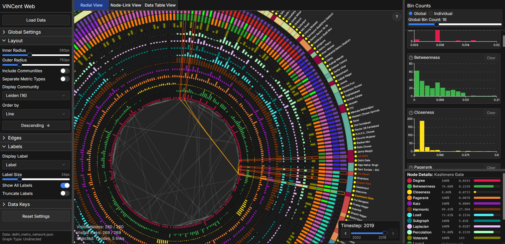

# Adrian Szuter - Master Thesis 2025

**ViNCent 2.0** is a web-based tool for interactive visualization and analysis of multivariate and temporal networks. It is a modern reimplementation of the original [ViNCent](https://ep.liu.se/konferensartikel.aspx?series=&issue=81&Article_No=12) system, rebuilt from Java/Prefuse into a full client-server web application.

The centerpiece is a **circular radial-bar diagram** where each node is represented as a stacked bar encoding multiple centrality measures and attributes simultaneously, coordinated with a **node-link diagram** and **data table view**.

**Highlights:**

- 25 centrality measures + 8 community detection algorithms
- Multivariate support for arbitrary categorical and numerical node attributes
- Temporal network navigation with foresighted layouts and visual change indicators
- Histogram and bar chart filtering, synchronized across all views
- Force-Directed Edge Bundling (FDEB) for dense networks
- Supports GraphML, CSV, MTX, adjacency matrix, and custom JSON formats

Built with **React / TypeScript / D3.js** and **Python / FastAPI / NetworkX**.



## Installation

> **Mac/Linux users:** Replace `copy` with `cp` and `venv\Scripts\activate` with `source venv/bin/activate` where applicable.

This project can be run in two ways:

1. **Manual Setup** - using Node.js and Python directly on your machine
2. **Containerized Setup** - using Docker or Podman

### Project Initialization

#### 1. Clone the repository

```bash
git clone https://gitlab.liu.se/ivis/theses/adrian-szuter-master-thesis-2025.git
```

#### 2. Configure environment variables

Copy the example env file:

```bash
copy .env.example .env
```

In the created **.env** file you can set the following environment variables:

```bash
COMPOSE_PROJECT_NAME=vincent               # Name of the docker compose container
BACKEND_PORT=8000                          # Port for the backend service
ALLOWED_ORIGINS=http://localhost:3000,*    # Allowed origins (CORS) (comma separated list with frontend URLs)
CELERY_BROKER_URL=redis://redis:6379/0     # Connection used by Celery to send tasks
CELERY_BACKEND_URL=redis://redis:6379/0    # Connection used by Celery to store task results
VITE_BACKEND_URL=http://localhost:8000     # Backend URL used by the frontend
VITE_PORT=3000                             # Port for the frontend service
```

Environment variables injected at runtime override those set during build.

---

### Option 1: Manual Setup

#### Requirements

- **Node.js** v18+
- **Python** 3.x+

#### 1. Backend setup

Create and activate a virtual environment:

```bash
cd backend
python -m venv venv
venv\Scripts\activate
```

Make sure the virtual enviornment is active.

Install the required dependencies **with:**

```bash
pip install -r requirements.txt
```

#### 2. Frontend setup

If you followed step 2, **Run:**

```bash
cd ../frontend
npm install
```

#### 3. Run the project

You need to run the frontend and backend in separate terminals.

Run this command in the terminal for the backend folder:

```bash
python run-dev.py
```

Run this command in the terminal for the frontend folder:

```bash
npm start
```

---

### Option 2: Containerized Setup

#### Requirements

- **Docker** or **Podman** (replace docker commands with podman)
- **Docker/Podman Compose** (usually part of docker/podman)

#### 1. Build and Run

```bash
docker compose -f compose.yml -f compose.dev.yml up --build
```

> **NOTE:** If you have already built the project and made no changes, use:
>
> ```bash
> docker compose -f compose.yml -f compose.dev.yml up
> ```

#### 2. Clean up

Run **CTRL+C** in the terminal and then:

```bash
docker compose -f compose.yml -f compose.dev.yml down
```

in order to exit and clean up the containers.

---

### Production

To run the production configuration instead:

```bash
docker compose -f compose.yml -f compose.prod.yml up --build
```

---

### Opening the App

Once either setup is running, open your browser at:

- Frontend: http://localhost:3000 (default)
- Backend: http://localhost:8000 (default)

---

## Usage

A demo video (`ViNCent_Web_Demo.mp4`) is included in this repository. You can open it with any standard media player to see the tool in action.

Simply download or clone the repo, then play the video to get a quick overview of how the tool works.

## Authors and acknowledgment

I would like to thank everyone who participated in the interviews for their time and insights, which helped shape the final version of the system. I am especially grateful to my supervisor, Prof. Dr. Andreas Kerren, and my examiner, Dr. Kostiantyn Kucher, for their invaluable feedback and guidance throughout this work, which helped refine the direction of the research and implementation and significantly improved its quality.

## License

MIT License

Copyright (c) 2026 Adrian Szuter

Permission is hereby granted, free of charge, to any person obtaining a copy
of this software and associated documentation files (the "Software"), to deal
in the Software without restriction, including without limitation the rights
to use, copy, modify, merge, publish, distribute, sublicense, and/or sell
copies of the Software, and to permit persons to whom the Software is
furnished to do so, subject to the following conditions:

The above copyright notice and this permission notice shall be included in all
copies or substantial portions of the Software.

THE SOFTWARE IS PROVIDED "AS IS", WITHOUT WARRANTY OF ANY KIND, EXPRESS OR
IMPLIED, INCLUDING BUT NOT LIMITED TO THE WARRANTIES OF MERCHANTABILITY,
FITNESS FOR A PARTICULAR PURPOSE AND NONINFRINGEMENT. IN NO EVENT SHALL THE
AUTHORS OR COPYRIGHT HOLDERS BE LIABLE FOR ANY CLAIM, DAMAGES OR OTHER
LIABILITY, WHETHER IN AN ACTION OF CONTRACT, TORT OR OTHERWISE, ARISING FROM,
OUT OF OR IN CONNECTION WITH THE SOFTWARE OR THE USE OR OTHER DEALINGS IN THE
SOFTWARE.
